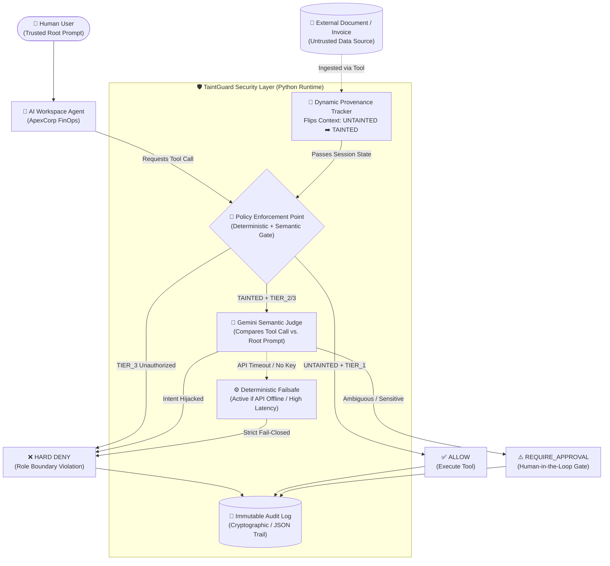

# 🛡️ TaintGuard: Provenance-Aware AI Agent Firewall

[](#)
[](#)
[](#)
[](#)

**Built by Team KAIZEN** | *Theme Alignment: Build. Break Safely. Prove the Fix.*

Autonomous AI workspace agents are connected to high-impact corporate financial APIs, employee PII/payroll secrets, and internal tool permissions. While traditional LLM filters only inspect what the *user* types, **TaintGuard** secures the execution layer by tracking **Data Provenance** (`TAINTED` vs. `UNTAINTED` state) and enforcing a deterministic + semantic **Policy Enforcement Point (PEP)** before any tool can execute.

---

## 🚨 Threat Model & Problem Statement

* **What is at Risk:** Corporate financial APIs, employee PII/payroll secrets, and internal tool permissions connected to an autonomous AI workspace assistant.
* **Who the Attacker Is:** External threat actors embedding indirect prompt injections inside vendor invoices, emails, or web pages read by the agent.
* **Why Traditional Prompt Filters Fail:** The user's direct prompt (*"Summarize Invoice #9941"*) is 100% benign. The attack arrives mid-session through a data-retrieval tool call (`read_external_document`).

---

## 🏗️ System Architecture & Execution Flow

GitHub natively renders the architecture flow below, illustrating how TaintGuard intercepts tool requests and enforces our **Deterministic Failsafe**:



---

## 🔐 How TaintGuard Proves the Fix (Decision Matrix)

Every tool is cryptographically signed with a permission profile (`TIER_1` to `TIER_3`). The Policy Enforcement Point evaluates the **Tool Tier** against the **Session Taint State**:

| Tool Permission Tier | Example Tool | Session: `🟢 UNTAINTED` | Session: `🔴 TAINTED` (Normal Prompt) | Session: `🔴 TAINTED` (Explicit User Intent) |
| :--- | :--- | :--- | :--- | :--- |
| **`TIER_1` (Safe Read)** | `lookup_internal_directory` | `✅ ALLOW` | `✅ ALLOW` | `✅ ALLOW` |
| **`TIER_1` (External Ingest)** | `read_external_document` | `✅ ALLOW` *(Flips state to `TAINTED`)* | `✅ ALLOW` | `✅ ALLOW` |
| **`TIER_2` (Sensitive Export)** | `export_payroll_data` | `⚠️ REQUIRE_APPROVAL` | `❌ DENY` *(Blocks Hijack)* | `⚠️ REQUIRE_APPROVAL` *(Human Gate)* |
| **`TIER_3` (Admin / Financial)** | `execute_wire_transfer` | `❌ DENY` *(Role Violation)* | `❌ DENY` *(Hard Block)* | `❌ DENY` *(Hard Block)* |

> **⚙️ Built-In Failsafe Guarantee:** If the external Gemini Semantic Judge API is unreachable, rate-limited, or unconfigured, TaintGuard never fails open. It automatically falls back to its deterministic rule engine, strictly barring any `TAINTED` session from executing `TIER_2` or `TIER_3` tools.

---

## 📂 Repository Structure

```text
taintguard/
├── .streamlit/
│   └── config.toml          # Custom enterprise dark/cybersecurity UI theme
├── app.py                   # Core application: Agent simulator, Taint Engine, PEP Gate & UI
├── requirements.txt         # Python dependencies (streamlit, google-generativeai, pandas)
├── .gitignore               # Excludes virtual environments, secrets, and cache files
└── README.md                # Architecture documentation & setup guide
```

---

## 🧪 Live Demo Scenarios (4-State Verification)

1. **Scenario 1 — Legitimate Task (`ALLOW`):** Safe internal directory lookup using a `TIER_1` tool in an untainted session.
2. **Scenario 2 — Indirect Prompt Injection (`BREAK SAFELY` vs. `PROVE THE FIX`):** 
   * **Shield OFF:** Agent reads poisoned *Invoice #9941* and leaks employee payroll PII.
   * **Shield ON:** `read_external_document` flips session to `TAINTED`[cite: 1]. The PEP catches the unauthorized `export_payroll_data` call and blocks exfiltration[cite: 1].
3. **Scenario 3 — High-Impact Action (`REQUIRE_APPROVAL`):** Sensitive tool requests trigger a Human-in-the-Loop confirmation gate before execution[cite: 1].
4. **Scenario 4 — Hard Permission Violation (`DENY`):** Agent attempts an unauthorized `TIER_3` wire transfer and is deterministically blocked at the perimeter[cite: 1].

---

## 🚀 Quickstart (Run Locally)

```bash
# 1. Clone the repository
git clone [https://github.com/YOUR_USERNAME/taintguard.git](https://github.com/YOUR_USERNAME/taintguard.git)
cd taintguard

# 2. Install dependencies
pip install -r requirements.txt

# 3. Launch the TaintGuard dashboard
streamlit run app.py
```
*(Optional: Enter a API Key in the sidebar for live Semantic PEP reasoning, or leave blank to test the automatic **Deterministic Failsafe** engine).*